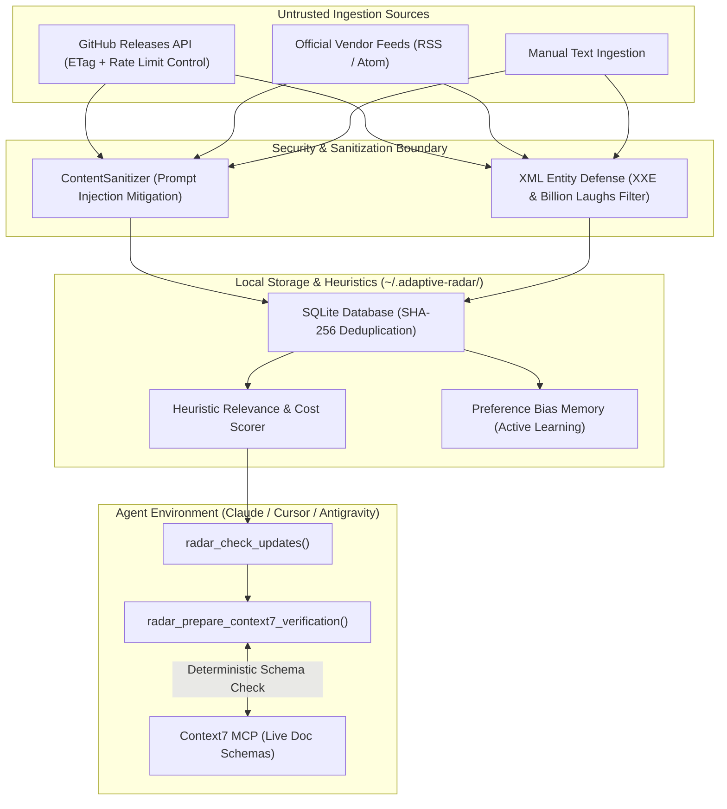

# Adaptive Tech Radar MCP

[](https://www.python.org/downloads/)
[](https://modelcontextprotocol.io/)
[](https://opensource.org/licenses/MIT)
[](https://peps.python.org/pep-0008/)

An autonomous Model Context Protocol (MCP) server that monitors upstream releases across the AI and LLMOps ecosystem, applies deterministic cost-reduction heuristics, and isolates your coding assistant from untrusted changelog injections.

Built for seamless verification workflows alongside [Context7 MCP](https://github.com/modelcontextprotocol).

---

## Technical Overview

Developers working with AI agents face a recurring trade-off when adopting new libraries:
- **Interface & Dependency Churn:** Adopting unverified releases that break existing code or inflate token burn.
- **Missed Platform Optimizations:** Overlooking architectural cost primitives (prompt caching, native structured outputs, or MCP schema introspection) that reduce inference costs by 30-70%.

Adaptive Tech Radar runs locally on your machine, tracks verified upstream feeds (GitHub Releases, official RSS/Atom), scores them against your configured stack profile, and sanitizes untrusted input before exposing it to your AI assistant.

---

## Architecture & Security Boundary



---

## Key Design Principles

### 1. Prompt Injection Risk Mitigation
Changelog notes written by third parties are untrusted input. The embedded `ContentSanitizer`:
- Normalizes Unicode characters via **NFKC** and strips zero-width/formatting characters (`Cf` category) to prevent character-level evasion.
- Strips instruction overrides (e.g., `ignore previous instructions`, `disregard rules`, `system prompt:`, `exfiltrate`).
- Cleans HTML markup, hidden comments, scripts, and dangerous URL protocols (`javascript:`, `data:`).
- Strips newlines and markdown heading markers from titles to prevent report structure spoofing.
- Truncates release bodies to prevent context exhaustion attacks.

### 2. Transparent Cost-Reduction Heuristics
Instead of opaque ROI claims, the engine uses explicit, documented heuristic signals:
- **Prompt Caching Detection:** Detects native provider caching hooks (`cache_control`, `prompt caching`).
- **Structured Output Support:** Identifies native JSON schema enforcement that eliminates validation retry loops.
- **Thinking Effort Controls:** Flags dynamic reasoning budget parameters.
- **Schema Compression:** Evaluates MCP database adapters that eliminate full DDL dumping in system prompts.

### 3. Native Context7 Integration
Provides the `radar_prepare_context7_verification` tool, which generates a structured verification plan (library name, version, and targeted queries) for Context7 MCP to confirm live API interfaces before any code is generated.

### 4. Zero Unauthenticated Dependency Lock-in
- Requires zero paid API keys out of the box.
- Supports conditional requests via **HTTP ETag** (`If-None-Match`) to minimize bandwidth and GitHub rate limits.
- Supports optional `GITHUB_TOKEN` environment variable to expand GitHub API limits from 60 to 5,000 requests/hour.
- Employs **defusedxml** to protect against XXE, Billion Laughs, and quadratic blowup attacks across all XML encodings.
- Implements response size limits (2 MB) and connection pooling via `httpx.AsyncClient` with bounded concurrency (`asyncio.Semaphore`).

---

## Installation & Configuration

### Option 1: uvx (Recommended)

Run directly from GitHub without cloning or local package installation:

```json
{
  "mcpServers": {
    "adaptive-radar": {
      "command": "uvx",
      "args": ["--from", "git+https://github.com/SerhiiHirus/adaptive-radar-mcp.git", "adaptive-radar-mcp"]
    }
  }
}
```

### Option 2: Local Development

```bash
git clone https://github.com/SerhiiHirus/adaptive-radar-mcp.git
cd adaptive-radar-mcp

python3 -m venv .venv
source .venv/bin/activate
pip install -e ".[dev]"

# Run test suite (16 tests)
pytest
```

To configure your client with the local virtualenv:
```json
{
  "mcpServers": {
    "adaptive-radar": {
      "command": "/absolute/path/to/adaptive-radar-mcp/.venv/bin/adaptive-radar-mcp",
      "args": [],
      "env": {
        "GITHUB_TOKEN": "optional_token_here",
        "RADAR_STORAGE_DIR": "~/.adaptive-radar"
      }
    }
  }
}
```

---

## Protocol Specification: Exposed Tools

| Tool | Parameters | Description |
| :--- | :--- | :--- |
| `radar_check_updates` | `fetch_remote: bool = True`, `limit: int = 5` | Fetches, sanitizes, and evaluates releases against developer preferences and cost metrics. |
| `radar_prepare_context7_verification` | `release_id: str` | Generates a structured Context7 payload (`library_id`, query) to verify official docs before implementation. |
| `radar_record_feedback` | `release_id: str`, `decision: str`, `reason: str` | Records user decisions (`ACCEPTED`, `REJECTED`, `OBSERVED`) to adjust heuristic bias weights. |
| `radar_set_stack_profile` | `keywords: list`, `preferred_tools: list`, `banned_patterns: list` | Updates architectural constraints and explicit pattern bans (e.g. heavy wrappers). |
| `radar_ingest_custom` | `title: str`, `body: str`, `source_url: str` | Manually sanitizes and ingests a custom changelog draft or announcement. |

---

## Testing

The test suite validates prompt injection defense, XML entity mitigation, concurrent request pooling, rate-limit resilience, SQLite isolation, and active learning adjustments:

```bash
pytest -v
```

---

## License

MIT License. Authored and maintained by Serhii Hirus.
