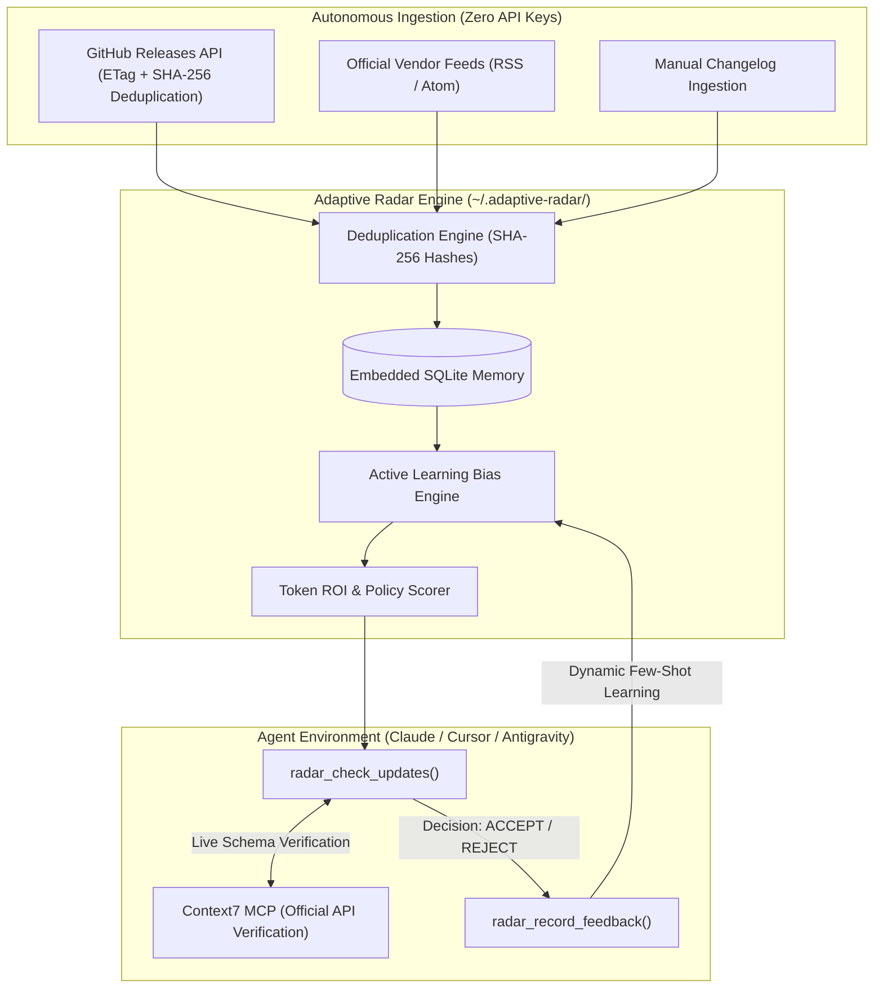

# Adaptive Tech Radar MCP

[](https://www.python.org/downloads/)
[](https://modelcontextprotocol.io/)
[](https://opensource.org/licenses/MIT)
[](https://peps.python.org/pep-0008/)

An autonomous, self-learning Model Context Protocol (MCP) server designed to monitor technical releases across the AI and LLMOps ecosystem, evaluate architectural applicability using **Active Learning**, and compute **Token ROI** prior to adoption.

Integrates with [Context7 MCP](https://github.com/modelcontextprotocol) for deterministic, zero-hallucination API schema verification.

---

## Overview

Software teams adopting LLM frameworks face two operational challenges:
1. **Unchecked Churn:** Blindly adopting experimental abstractions that break existing interfaces, introduce supply chain vulnerabilities, or significantly increase inference token overhead.
2. **Delayed Optimization:** Missing foundational platform updates (such as API-level prompt caching, native structured outputs, or compact schema introspection) that reduce operational token expenditures by 50-80%.

Adaptive Tech Radar MCP monitors upstream releases, compares them against a user-defined architectural profile, and dynamically refines its scoring based on human acceptance and rejection patterns.

---

## Architecture & Data Flow



---

## Core Capabilities

- **Keyless Autonomous Monitoring:** Continuously tracks upstream packages via public GitHub endpoints and RSS/Atom feeds using connection pooling (`httpx`), concurrent dispatch (`asyncio.gather`), and SHA-256 deduplication.
- **Active Learning Preference Engine:** Maintains a historical vector of developer decisions (`ACCEPTED` / `REJECTED`). Unwanted architectural patterns (e.g., heavy orchestration layers) are automatically downranked over time.
- **Token ROI Evaluation:** Scores releases based on explicit cost-reduction primitives: prompt caching, thinking effort controls, schema compression, and structured output enforcement.
- **Execution & Supply Chain Boundaries:** Rejects dangerous runtime patterns (arbitrary `eval`, unconstrained subshell execution, unverified dynamic agents).
- **Context7 Synergy:** Automatically suggests targeted queries for Context7 MCP to confirm live API signatures before implementation code is generated.

---

## Installation & Configuration

### Option 1: uvx (Recommended)

Add directly to your client MCP configuration (`claude_desktop_config.json`, Cursor, or Antigravity):

```json
{
  "mcpServers": {
    "adaptive-radar": {
      "command": "uvx",
      "args": ["adaptive-radar-mcp"]
    }
  }
}
```

### Option 2: Local Development

```bash
git clone https://github.com/SerhiiHirus/adaptive-radar-mcp.git
cd adaptive-radar-mcp

python3 -m venv .venv
source .venv/bin/activate
pip install -e ".[dev]"

# Run test suite
pytest
```

---

## Protocol Specification: Exposed Tools

| Tool | Parameters | Description |
| :--- | :--- | :--- |
| `radar_check_updates` | `fetch_remote: bool = True`, `limit: int = 5` | Collects, filters, and scores recent updates against the developer profile and Token ROI metrics. |
| `radar_record_feedback` | `release_id: str`, `decision: str`, `reason: str` | Records user feedback (`ACCEPTED`, `REJECTED`, `OBSERVED`) to adjust active learning weights. |
| `radar_set_stack_profile` | `keywords: list`, `preferred_tools: list`, `banned_patterns: list` | Configures architectural constraints, preferred packages, and explicit exclusions. |
| `radar_ingest_custom` | `title: str`, `body: str`, `source_url: str` | Ingests a raw text draft, issue, or changelog snippet for immediate scoring. |

---

## Verification Workflow with Context7 MCP

Adaptive Radar is designed to operate alongside Context7 to eliminate hallucinations during library upgrades:

1. **Radar Identifies High-ROI Release:**
   ```
   [IMPLEMENT] PydanticAI v2.65.0: Dynamic thinking effort controls.
   Token ROI: Saves 30-50% tokens by reducing reasoning steps on trivial extractions.
   ```
2. **Context7 Confirms Documentation:**
   The agent queries live library schemas:
   ```
   mcp_context7_query-docs(library_id='pydantic-ai', query='thinking effort')
   ```
3. **Deterministic Implementation:**
   The assistant constructs implementation code against validated, production-ready interfaces.

---

## Test Verification

The test suite validates XML security defenses (XXE / Entity Expansion mitigation), concurrent crawler execution, rate-limit resilience, SQLite isolation, and active learning weight adjustments:

```bash
pytest -v
```

---

## License

MIT License. Authored and maintained by Serhii Hirus.
