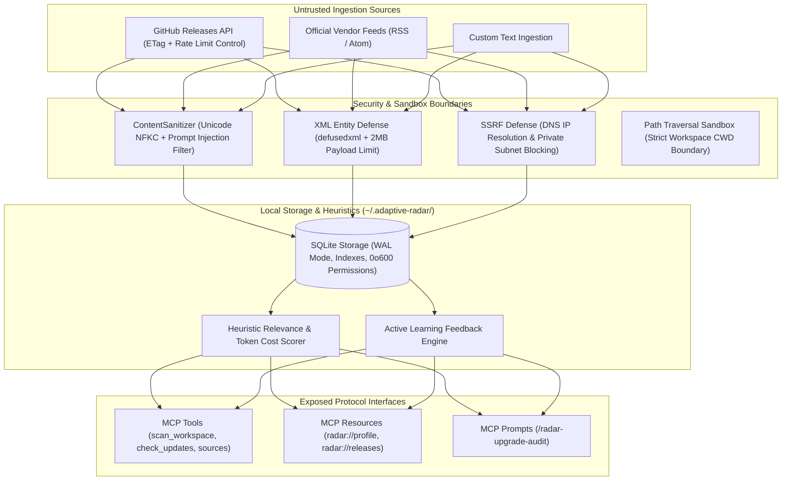

# Adaptive Tech Radar MCP

[](https://www.python.org/downloads/)
[](https://modelcontextprotocol.io/)
[](https://opensource.org/licenses/MIT)
[](https://peps.python.org/pep-0008/)

An autonomous Model Context Protocol (MCP) server that monitors upstream releases across the AI and LLMOps ecosystem, scans local workspace dependencies (`pyproject.toml`, `requirements.txt`), evaluates cost-reduction signals, and mitigates untrusted prompt injections.

Integrates seamlessly with [Context7 MCP](https://github.com/modelcontextprotocol) for zero-hallucination API schema verification.

---

## Technical Overview

Developers adopting AI libraries face two recurring operational challenges:
- **Dependency & API Churn:** Upgrading to unverified releases that break existing code or inflate token burn.
- **Missed Platform Optimizations:** Overlooking architectural cost primitives (prompt caching, native structured outputs, or compact schema introspection) that reduce inference costs by 30-70%.

Adaptive Tech Radar connects your AI coding assistant to verified upstream releases (GitHub Releases, official RSS/Atom), evaluates them against dependencies actually present in your project, and sanitizes untrusted input before exposing it to the agent.

---

## Architecture & Security Model



---

## Protocol Specification

### 1. Exposed MCP Tools

| Tool | Parameters | Description |
| :--- | :--- | :--- |
| `radar_scan_workspace` | `directory: str = "."` | Safely parses `pyproject.toml`, `requirements.txt`, or `package.json` within project boundaries to detect active dependencies (Strictly Read-Only). |
| `radar_check_updates` | `fetch_remote: bool = True`, `limit: int = 5` | Fetches, sanitizes, and evaluates releases against developer stack and Token Cost metrics. |
| `radar_prepare_context7_verification` | `release_id: str` | Generates a structured Context7 payload (`library_id`, query) to verify official docs before implementation. |
| `radar_add_source` | `source_type: str`, `target: str`, `name: str` | Adds a GitHub repo (`owner/repo`) or HTTPS RSS feed with strict SSRF validation (private/loopback IPs blocked). |
| `radar_list_sources` | _None_ | Lists all active upstream tracking sources and configurations. |
| `radar_remove_source` | `identifier: str` | Removes a tracked source by repo name or feed URL. |
| `radar_record_feedback` | `release_id: str`, `decision: str`, `reason: str` | Records user decisions (`ACCEPTED`, `REJECTED`, `OBSERVED`) to adjust heuristic bias weights. |
| `radar_set_stack_profile` | `keywords: list`, `preferred_tools: list`, `banned_patterns: list` | Updates architectural constraints and explicit pattern bans. |
| `radar_ingest_custom` | `title: str`, `body: str`, `source_url: str` | Manually sanitizes and ingests a custom changelog draft or announcement. |

### 2. Exposed MCP Resources

Clients can read radar state directly without incurring tool-call latency or side effects:

- `radar://profile` — Active developer stack profile, preferences, and exclusions (JSON).
- `radar://releases/recent` — Recent unreviewed release metadata (`id`, `title`, `url`, `version`). **Raw markdown bodies are strictly excluded** to prevent context hijacking when resources are auto-loaded.
- `radar://sources` — Active tracking sources and configurations (JSON).

### 3. Exposed MCP Prompts

- `radar-upgrade-audit` — A standardized workflow prompt guiding your AI assistant to:
  1. Scan workspace dependencies via `radar_scan_workspace`.
  2. Match against recent verified high-ROI releases.
  3. Validate API syntax via Context7 MCP.
  4. Formulate a verified implementation plan.

---

## Security Defenses

1. **Prompt Injection Mitigation:** All incoming titles and bodies are normalized using Unicode NFKC. Formatting characters (`Cf` category) are stripped prior to applying directive filters (`ignore instructions`, `system prompt:`, `exfiltrate`).
2. **SSRF Defense:** Adding RSS feeds resolves the target hostname and blocks loopback (`127.0.0.0/8`), private networks (RFC 1918), and link-local cloud metadata endpoints (`169.254.169.254`). GitHub additions require exact `owner/repo` patterns.
3. **Workspace Path Sandbox:** `radar_scan_workspace` strictly confines file reads to the workspace root, rejecting path traversal attempts (`../`) and parsing only dependency fields.
4. **Hardened XML Parser:** RSS/Atom feeds are parsed using `defusedxml` to mitigate Billion Laughs, quadratic blowup, and DTD entity attacks in any encoding.
5. **Local Concurrency (SQLite WAL):** SQLite connections enforce `PRAGMA journal_mode = WAL` and `busy_timeout = 5000` to prevent concurrency deadlocks across multiple IDE sessions.

---

## Installation & Configuration

### Option 1: uvx (Zero Installation)

Add directly to your client MCP configuration (`claude_desktop_config.json`, Cursor, or Antigravity):

```json
{
  "mcpServers": {
    "adaptive-radar": {
      "command": "uvx",
      "args": ["--from", "git+https://github.com/SerhiiHirus/adaptive-radar-mcp.git", "adaptive-radar-mcp"]
    }
  }
}
```

### Option 2: Local Development

```bash
git clone https://github.com/SerhiiHirus/adaptive-radar-mcp.git
cd adaptive-radar-mcp

python3 -m venv .venv
source .venv/bin/activate
pip install -e ".[dev]"

# Run test suite (30 unit tests)
pytest
```

---

## Testing

```bash
pytest -v
```

All 30 unit tests cover prompt injection sanitization, SSRF blocking, path traversal prevention, SQLite WAL mode, ETag caching, defusedxml defenses, and MCP resources.

---

## License

MIT License. Authored and maintained by Serhii Hirus.
