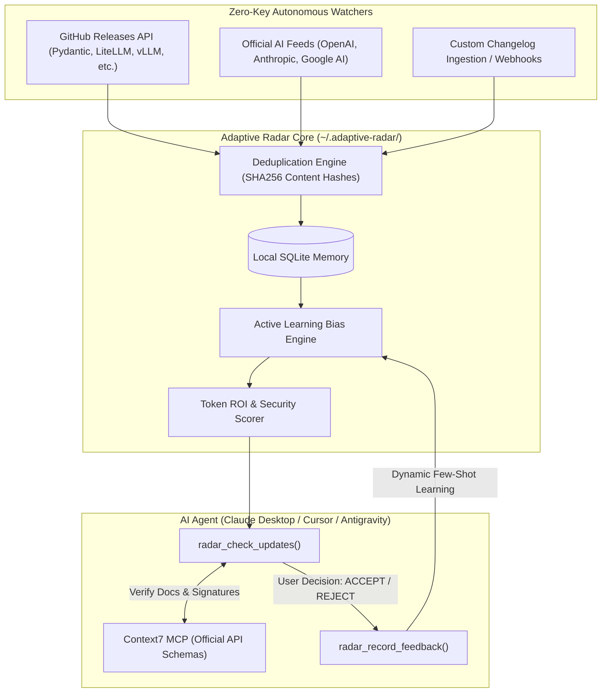

# 🛰️ Adaptive Tech Radar MCP

[](https://www.python.org/downloads/)
[](https://modelcontextprotocol.io/)
[](https://opensource.org/licenses/MIT)
[](https://github.com/astral-sh/ruff)

An autonomous, self-learning Model Context Protocol (MCP) server that monitors cutting-edge AI, LLMOps, and developer tool releases, validates them against your architectural preferences via **Active Learning**, and estimates **Token ROI** before you adopt them.

Pairs seamlessly with [Context7 MCP](https://github.com/modelcontextprotocol) for zero-hallucination schema verification.

---

## 💡 The Problem

Every week, dozens of AI frameworks, models, and libraries release updates. Most engineering teams face two failure modes:
1. **The Hype Trap:** Blindly adopting raw, unstable abstractions that break production, introduce security vulnerabilities, and 3x prompt token consumption.
2. **The Stagnation Trap:** Missing out on game-changing releases (like prompt caching, native structured outputs, or MCP schema servers) that could cut operational token costs by 50-80%.

**Adaptive Tech Radar MCP solves this autonomously without requiring paid API keys.**

---

## 🏛️ Architecture & Flow



---

## ⚡ Key Features

- 🔄 **Autonomous Ingestion (Zero Keys):** Continuously tracks releases using public GitHub and RSS/Atom feeds with ETag and SHA-256 deduplication.
- 🧠 **Active Learning Memory:** Learns from your decisions (`ACCEPTED` / `REJECTED`). If you reject heavy orchestration frameworks, the system automatically downranks similar libraries and biases towards your preferred tools (e.g., Pydantic, FastAPI).
- 💰 **Token ROI Scoring:** Automatically identifies features that reduce token spend (prompt caching, structured output enforcement, thinking effort controls, compact MCP schemas).
- 🛡️ **Supply Chain & Prompt Injection Defense:** Pre-screens updates for unsafe dynamic evaluation (`eval`), arbitrary shell execution, and breaking releases.
- 🤝 **Synergy with Context7 MCP:** Produces structured queries for Context7 so your assistant verifies live API signatures before writing code.

---

## 🚀 Quickstart

### Option 1: Run with `uvx` (Recommended)

No installation required. Add directly to your Claude Desktop, Cursor, or Antigravity MCP configuration:

```json
{
  "mcpServers": {
    "adaptive-radar": {
      "command": "uvx",
      "args": ["adaptive-radar-mcp"]
    }
  }
}
```

### Option 2: Local Development

```bash
git clone https://github.com/serhiihirus/adaptive-radar-mcp.git
cd adaptive-radar-mcp

python3 -m venv .venv
source .venv/bin/activate
pip install -e ".[dev]"

# Run tests
pytest
```

---

## 🛠️ MCP Tools Exposed

| Tool | Parameters | Description |
| :--- | :--- | :--- |
| `radar_check_updates` | `fetch_remote: bool = True`, `limit: int = 5` | Fetches, screens, and scores the latest updates against your stack and token ROI. |
| `radar_record_feedback` | `release_id: str`, `decision: str`, `reason: str` | Records user feedback (`ACCEPTED`, `REJECTED`, `OBSERVED`) to train active learning memory. |
| `radar_set_stack_profile` | `keywords: list`, `preferred_tools: list`, `banned_patterns: list` | Configures your current architectural stack and constraints. |
| `radar_ingest_custom` | `title: str`, `body: str`, `source_url: str` | Ingests a raw changelog draft or article manually. |

---

## 🤝 Pairing with Context7 MCP

For the ultimate agentic workflow, run **Adaptive Radar** alongside **Context7**:

1. **Radar flags high-ROI release:**
   > `[IMPLEMENT] PydanticAI v2.65: Dynamic thinking effort control. Token ROI: Saves 30-50% tokens.`
2. **Context7 verifies live docs:**
   The agent calls `mcp_context7_query-docs(library_id='pydantic-ai', query='thinking effort')`.
3. **Verified Implementation:**
   The agent writes production code using verified, non-hallucinated syntax.

---

## 🧪 Testing

The test suite covers crawling, parsing, SQLite deduplication, scoring, and active learning feedback:

```bash
pytest -v
```

---

## 📄 License

MIT License. Designed and maintained by **Serhii Hirus**.
